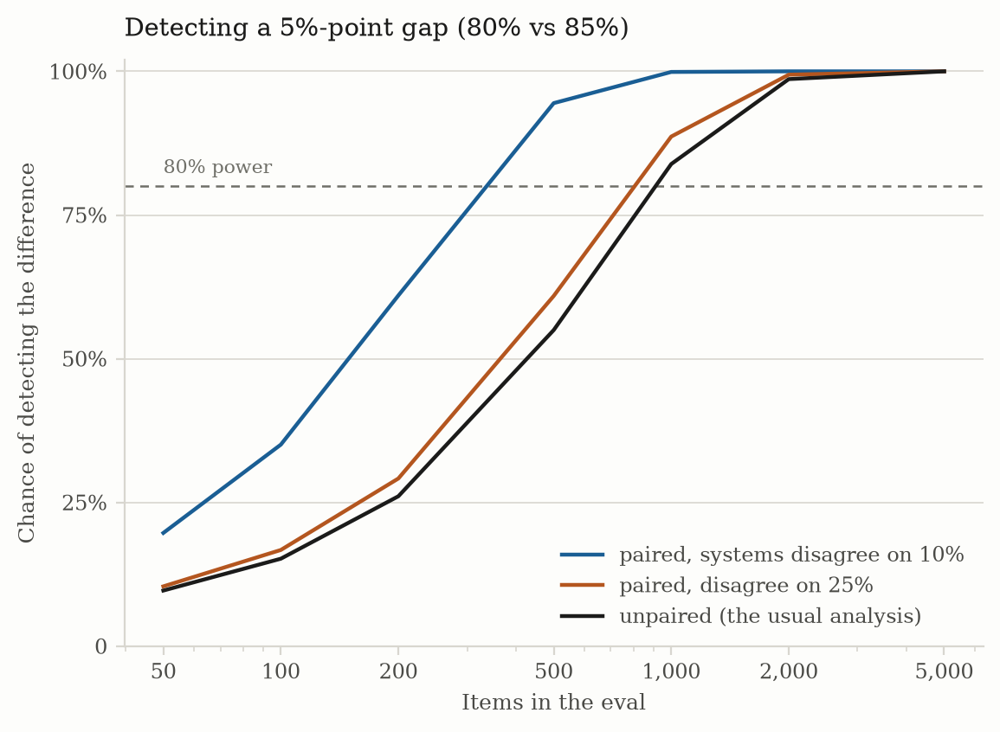
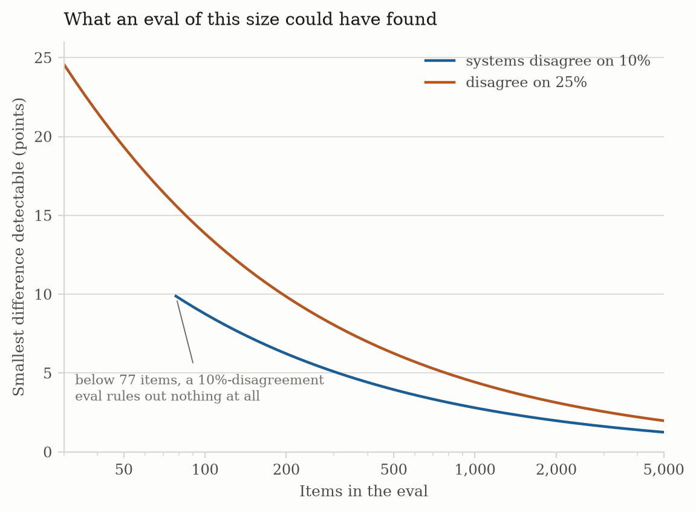
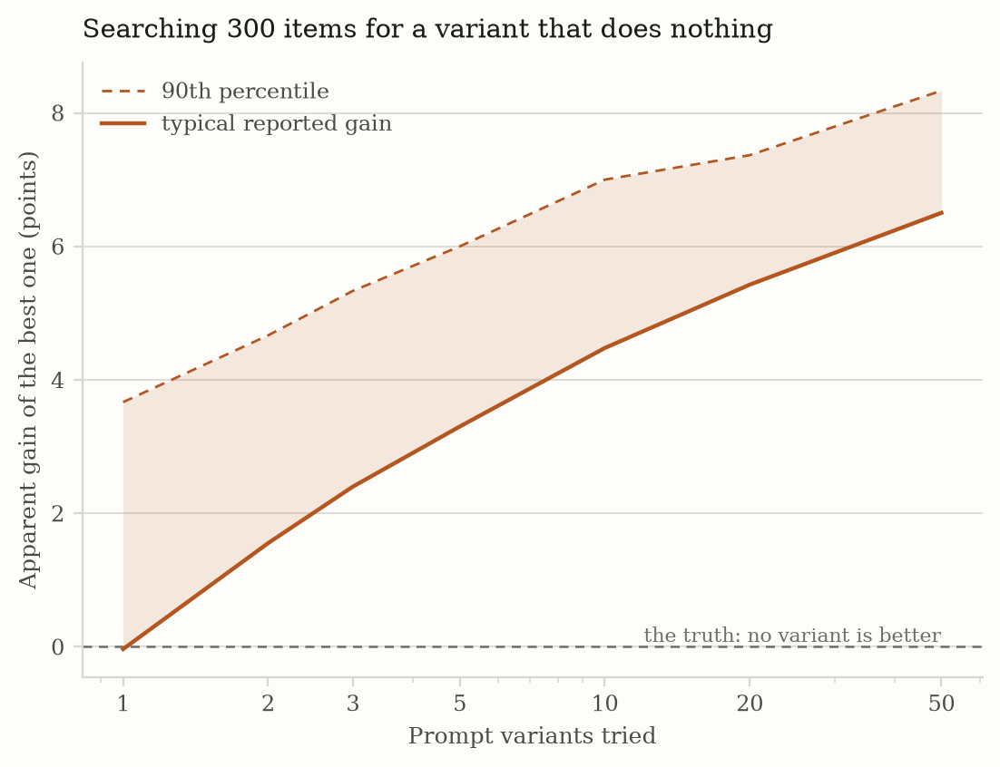

# Results — When Evals Can't Tell

_Auto-generated by `study.py`. Every number is computed; none is typed in._

## Headline figures
| Figure | Value |
|---|---|
| Comparison | **80%** vs **85%**, a 5-point gap |
| Power at 100 items, unpaired | **15%** |
| Power at 100 items, paired | **17%**–**35%** |
| Items needed for 80% power, unpaired | **903** |
| Items needed for 80% power, paired | **312**–**783** |
| Smallest difference 100 items can detect | **13.8** points |

## 1. Most evals cannot see the difference they report

| Items | Unpaired | Paired, disagree 25% | Paired, disagree 10% |
|---|---|---|---|
| 50 | 10% | 10% | 20% |
| 100 | 15% | 17% | 35% |
| 200 | 26% | 29% | 61% |
| 500 | 55% | 61% | 94% |
| 1,000 | 84% | 89% | 100% |
| 2,000 | 99% | 99% | 100% |
| 5,000 | 100% | 100% | 100% |

At 100 items the usual analysis notices a 5-point gap 15% of the time. Reaching 80% power takes **903** items unpaired, or **312** paired when the systems disagree on only 10%.

## 2. Pairing helps most when the systems are most alike

Keeping the pairing is worth 120 items when the systems disagree on 25%, and 591 when they disagree on 10%. The information lives in the items the systems disagree on, so two near-identical systems are the easy case, not the hard one — the opposite of the intuition that similar systems are harder to tell apart.

## 3. What an eval that found nothing has ruled out

| Items | Disagree 25% | Disagree 10% |
|---|---|---|
| 50 | 19.3 points | nothing |
| 100 | 13.8 points | 8.7 points |
| 200 | 9.8 points | 6.2 points |
| 500 | 6.4 points | 4.0 points |
| 1,000 | 4.5 points | 2.9 points |
| 2,000 | 3.2 points | 2.0 points |

"No significant difference" on 100 items rules out differences larger than about 14 points. It does not rule out a difference.

The 10% column stops short because a difference cannot exceed the rate at which the systems disagree. Under 10% disagreement an eval of fewer than 77 items cannot rule out any difference at all, however the test comes out.

## 4. The cost of trying several prompts

| Variants tried | Typical gain of the best | 90th percentile | Share showing a gain |
|---|---|---|---|
| 1 | -0.03pp | +3.67pp | 46% |
| 2 | +1.55pp | +4.67pp | 70% |
| 3 | +2.40pp | +5.33pp | 84% |
| 5 | +3.30pp | +6.00pp | 95% |
| 10 | +4.48pp | +7.00pp | 100% |
| 20 | +5.43pp | +7.37pp | 100% |
| 50 | +6.50pp | +8.33pp | 100% |

None of these variants is better than the baseline. Every gain in the table is selection. Try 50 and the best one shows **+6.50pp** on average and clears the baseline in 100% of runs, which is the number a write-up reports after keeping the winner.

## Figures
- `figures/01_power.png`
- `figures/02_detectable.png`
- `figures/03_selection.png`